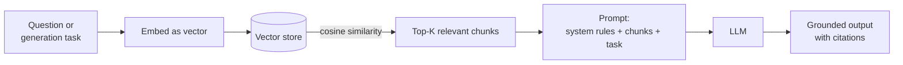
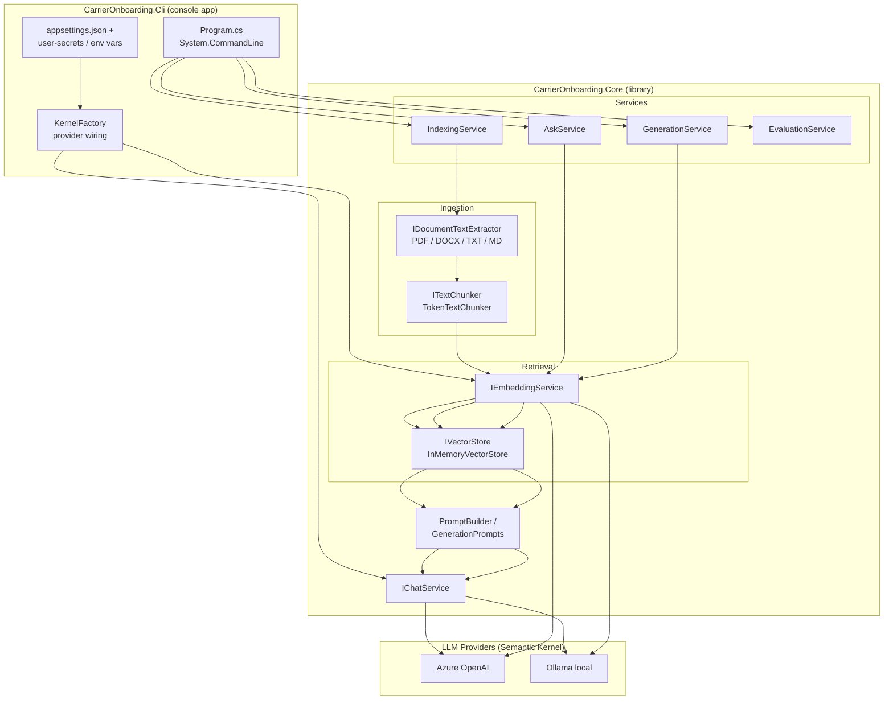
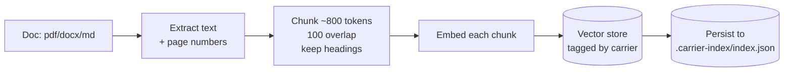
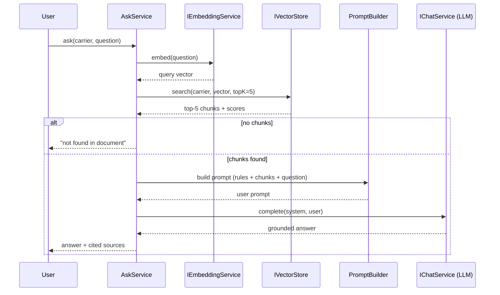
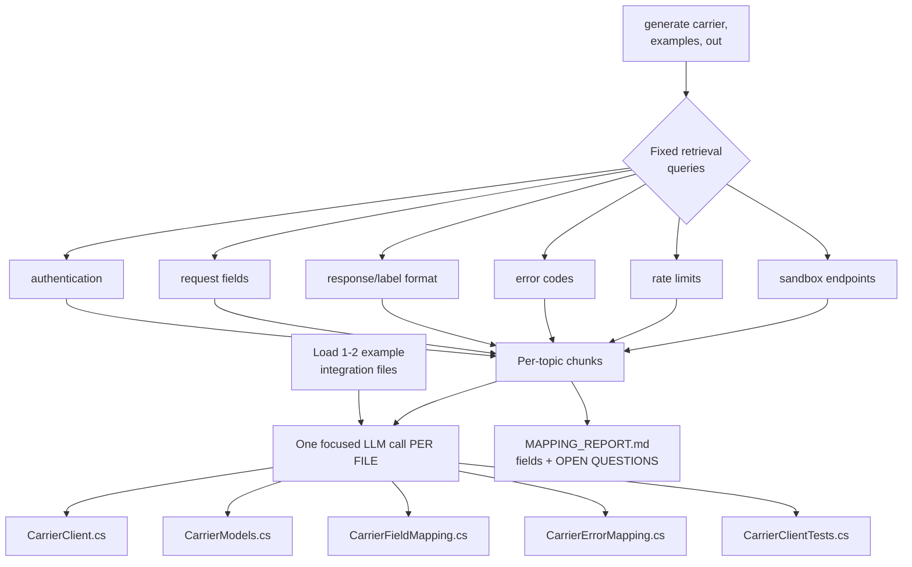
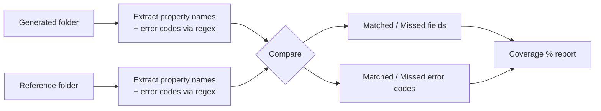
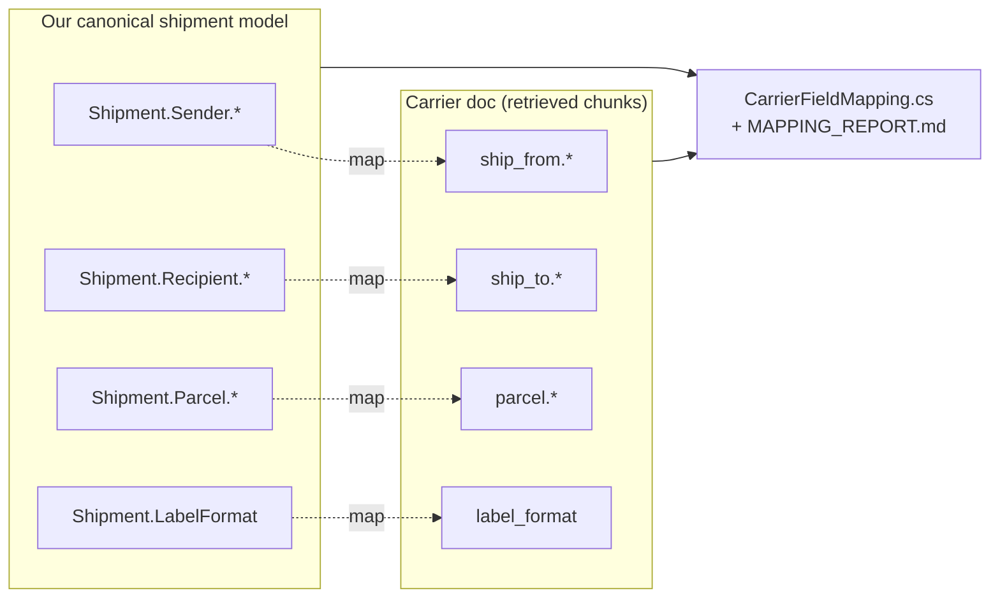
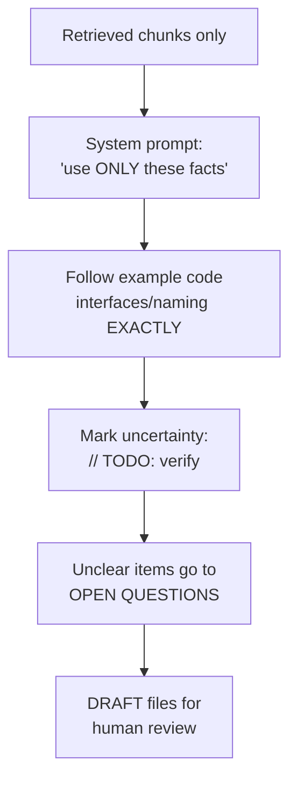

# Architecture & Design — Carrier Onboarding Assistant

This document explains **what the tool does**, **how it works**, and **the technology behind it**,
with diagrams. The GitHub Markdown renderer draws the `mermaid` code blocks as diagrams.

---

## 1. The problem & the idea

Onboarding a new shipping carrier means an engineer reads a long API integration guide and
hand-writes a C# integration (client, request/response models, field mappings, error mapping,
tests). It is slow and repetitive.

A plain LLM can't be trusted to do this: it will **hallucinate** endpoints, field names and
error codes that aren't in the carrier's doc. The fix is **Retrieval-Augmented Generation (RAG)**:
we ground every answer in the *actual* document and force the model to use only retrieved facts,
flagging anything uncertain with `// TODO: verify`.

> The tool **never deploys**. It only writes **DRAFT** files for a human to review.

---

## 2. What is RAG (in one picture)



- **Embedding** turns text into a vector (array of numbers) that captures *meaning*.
- Similar meaning → similar vectors → high **cosine similarity**.
- We retrieve only the most relevant chunks and tell the LLM to answer **only** from them.

---

## 3. High-level system architecture



**Why this shape?** `Core` depends only on **interfaces**. The CLI injects the concrete
LLM provider and the vector store. That keeps the business logic provider-agnostic and lets
us swap the vector store (in-memory → SQLite/Qdrant) by changing one registration.

---

## 4. The four commands as data flows

### 4.1 `index` — ingest a carrier document



Key detail: **overlap** means consecutive chunks share ~100 tokens, so a sentence split
across a boundary is never lost. Each chunk remembers its **section heading** and **page**
for citations.

### 4.2 `ask` — grounded Q&A with citations



The **system prompt** forces: *use only the excerpts, cite section/page, say
"not found in document" if absent, never invent values.*

### 4.3 `generate` — draft an integration (one LLM call per file)



- **Few-shot examples** (`--examples`) teach the model your house naming/logging/exception style.
- **One file per call** keeps each prompt small, focused and accurate.
- **`MAPPING_REPORT.md`** lists each carrier field, your source field, the doc section it came
  from, and an **OPEN QUESTIONS** section for anything unclear — nothing is invented.

### 4.4 `evaluate` — grade a draft (no LLM)



Pure static string analysis — deterministic and offline, so it needs **no LLM provider**.

---

## 5. Request/response model mapping (what `generate` reasons about)



---

## 6. The technology behind it

| Concern | Technology | Why |
|---|---|---|
| CLI parsing | **System.CommandLine** | Typed options, subcommands, built-in `--help` |
| LLM orchestration | **Microsoft Semantic Kernel** | One abstraction over chat + embeddings |
| LLM providers | **Azure OpenAI** / **Ollama** | Cloud or fully local; selectable in config |
| PDF text | **UglyToad.PdfPig** | Reliable per-page text extraction |
| Word text | **DocumentFormat.OpenXml** | First-party `.docx` parsing |
| Vectors | **In-memory cosine store** (+ JSON persistence) | Simple start; swappable behind `IVectorStore` |
| Config & DI | **Microsoft.Extensions.*** | Options binding, user-secrets, logging, DI |
| Tests | **xUnit** | Chunking, retrieval (fake embedder), prompts, eval |

### How similarity is computed (cosine)

Two vectors `a` and `b`:

```
similarity = (a · b) / (‖a‖ × ‖b‖)
```

- `a · b` is the dot product (overlap of meaning).
- Dividing by the magnitudes makes it **length-independent** — only *direction* (meaning) matters.
- Result in `[0, 1]`; higher = more relevant. We sort chunks by this and take the top-K.

### Chunking math (why ~800/100)

- LLMs and embeddings have token limits and lose precision on very long text.
- ~**800 tokens** ≈ a focused, self-contained passage.
- **100-token overlap** preserves context across boundaries.
- Tokens are estimated as `chars / 4` (a good cross-model heuristic) in `TokenEstimator`.

---

## 7. Guardrails that keep output trustworthy



1. **Grounding** — only retrieved document text is used as source of carrier facts.
2. **Pattern fidelity** — few-shot examples enforce your coding conventions.
3. **Explicit uncertainty** — `// TODO: verify` + an OPEN QUESTIONS list; nothing invented.
4. **Human-in-the-loop** — everything is a draft; the tool never deploys.

---

## 8. Project layout recap

```
src/
  CarrierOnboarding.Core/     Abstractions, Ingestion, Vector, Llm, Prompts, Services, DI
  CarrierOnboarding.Cli/      Program.cs (commands), KernelFactory, appsettings.json
tests/
  CarrierOnboarding.Tests/    Chunking, retrieval (fake embedder), prompt building, evaluation
samples/
  docs/      acmeship-api-guide.md  (fictional carrier doc)
  examples/  ZipShip* .cs           (house pattern / evaluation reference)
```

See **[HOW_TO_RUN.md](HOW_TO_RUN.md)** for setup and example commands, and
**[README.md](README.md)** for a feature overview.
